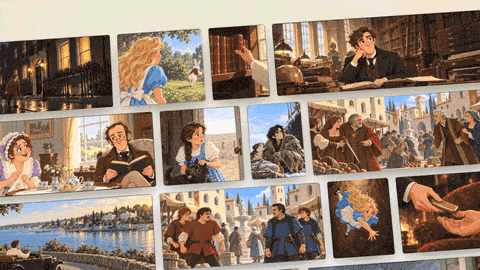
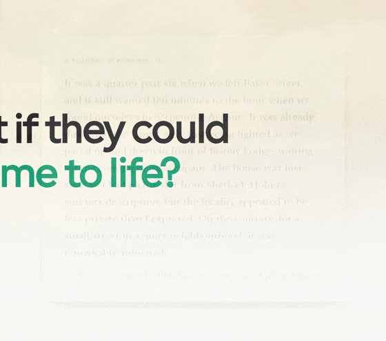
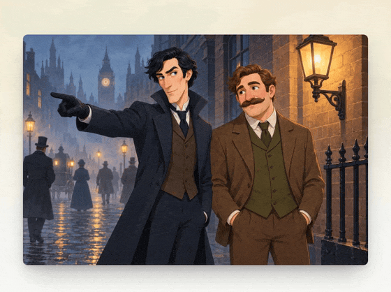
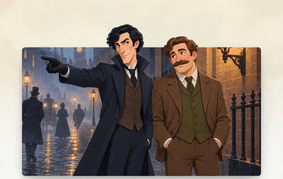
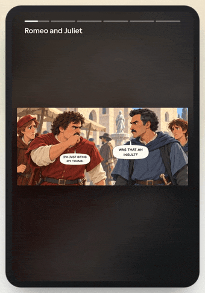

# Storieta Reels

A standalone Meta demo for [Storieta](https://storieta.com): turn a book passage into an illustration with separate character and background layers.

<p align="center">
  
</p>

## Pipeline

1. **Muse Wonder** reads the passage and selects a moment to illustrate.
2. **Muse Image** generates the scene from Wonder's selected moment.
3. **SAM 3.1** masks the figures in the scene.
4. **Muse Wonder** matches numbered figure masks to story characters.
5. **Muse Image** paints the background behind the characters for separate layers.

This repository contains the passage-to-layers pipeline and a standalone demo player. Storieta’s production reader, catalog processing, and product integrations are separate. See [scope and provenance](SCOPE.md).

### From passage to scene

**Muse Wonder reads the passage and selects a moment.**

<p align="center">
  
</p>

**Muse Image paints the selected moment. SAM outlines the figures; Muse Wonder identifies the cast.**

<p align="center">
  
</p>

**Characters and background become separate layers.**

<p align="center">
  
</p>

## Try the demo — no API key

From the repository root:

```bash
python3 -m http.server 8000 --bind 127.0.0.1
```

Open [localhost:8000/web/](http://localhost:8000/web/). Scroll or swipe between three scenes, inspect the cast, separate the layers, adjust depth, compare the original, or open the scene wall. Arrow keys work when the scene area is focused. Motion can be paused and respects reduced-motion preferences.

## Generate your own scene

Requires Python 3.12+ and a Meta Model API key. From the repository root:

```bash
python3 -m venv .venv
.venv/bin/pip install -r requirements.txt
export META_MODEL_API_KEY="your-key"
PYTHONPATH=pipeline .venv/bin/python -m reel.scene work/scene examples/sherlock-scene/brief.json
```

The [example brief](examples/sherlock-scene/brief.json) uses the included passage. Outputs in `work/scene/` include `reading.json`, `scene.png`, `marked.jpg`, `casting.json`, transparent `cast-<n>.png` layers, `room.png`, and a player manifest, `reel.json`.

With the same server running, open [the generated scene](http://localhost:8000/web/?manifest=../work/scene/reel.json). All image paths are relative to the manifest.

To swipe through several generated scenes, combine their manifests:

```bash
PYTHONPATH=pipeline .venv/bin/python -m reel.playlist work/collection.json work/scene/reel.json work/another-scene/reel.json
```

Open `http://localhost:8000/web/?manifest=../work/collection.json`.

API responses are cached in `work/cache/`; estimated costs are logged in `work/spend.log`.

## Product recording

<p align="center">
  
</p>

## Tests

```bash
.venv/bin/python -m unittest discover -s pipeline/tests -v
```

## License

Code: [Apache-2.0](LICENSE). Demo artwork and recordings belong to Storieta and are excluded from the code license. Story text comes from public-domain works.
